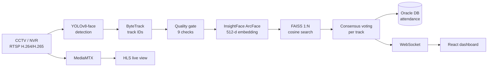

# Factory Face Recognition — CCTV Attendance at Shift-Change Scale

Real-time face recognition on existing factory CCTV. Cameras that were only recording now
log attendance on their own: detect → track → quality-check → embed → match → write to the
ERP database → push to a live dashboard.

Running in production at a factory with **~19,000 enrolled employees**.

> **Source code is private** (client deployment, built in a team of two). This repository
> documents the system, the engineering decisions, and the parts I built.

---

## Pipeline



| Stage | What it does |
|---|---|
| Detection | YOLOv8n-face on every sampled frame |
| Tracking | ByteTrack keeps one ID per person across frames, so decisions are made per *person*, not per frame |
| Quality gate | Size, detector confidence, yaw, pitch (up/down), brightness, blur, facial detail — every failing check is recorded, not just the first |
| Embedding | ArcFace (buffalo_l) on **every** crop, good or bad, combined per track with quality weights |
| Matching | FAISS cosine search with a threshold **and** a margin over the second-best candidate |
| Decision | Four rules per track — single, fused, frontal, time-spaced agreement (see below); 30 s cooldown per person |
| Output | Attendance rows in Oracle, live events over WebSocket, evidence crops on disk |

---

## The problems worth reading about

### 1. The quality filter was throwing away most real faces

A 5-minute live sample: **1,091 face crops from 36 people — only 22% passed every check.**
The rest were discarded before they were ever matched. Factory CCTV is wide-angle and
mounted high: faces are small, looking down, and turned sideways.

Loosening thresholds would have let bad crops produce false matches. Instead, **every crop
of every person is embedded** — good and bad alike, best-looking first — and the person is
decided from all of them by four rules, tried in order:

| # | Rule | When it fires |
|---|---|---|
| 1 | **Single** | One crop that passes the quality gate matches clearly (score ≥ threshold **and** a margin over the 2nd-best employee) |
| 2 | **Fused** | The quality-weighted average of all crops' embeddings matches clearly. Bad crops count at 30% of their weight, and this rule needs at least one good crop — bad crops can never produce a match through averaging alone |
| 3 | **Frontal** | ≥ 2 good, front-facing crops (low yaw/pitch) independently agree with the fused match — built for distant CCTV faces |
| 4 | **Agreement** | No good crop at all, but **≥ 3 crops taken ≥ 0.5 s apart** each name the **same employee** (score ≥ 0.30, margin ≥ 0.03), and no other employee has as many votes |

**Why the 0.5 s spacing matters:** consecutive frames share the same blur, angle and light,
so they repeat the same mistake. Crops half a second apart are closer to independent
witnesses. In the real example below, 29 crops over 2.3 s were all rejected by the old
filter; on their own, neighbouring crops guessed *different* employees — but 3 crops taken
≥ 0.5 s apart named the same person (cosine 0.36, 0.35, 0.39), so the new rule recognises
them.

```
crop  +0.0s  31px  guess: employee A   0.27
crop  +0.4s  31px  guess: employee B   0.32
crop  +0.8s  31px  VOTE  employee X   0.36  ◄
crop  +1.0s  32px  guess: employee C   0.33
crop  +1.3s  32px  VOTE  employee X   0.35  ◄  ≥ 0.5 s after the previous vote
crop  +1.4s  31px  (same X, but < 0.5 s later — not counted)
crop  +1.9s  35px  VOTE  employee X   0.39  ◄  3 spaced votes → RECOGNISED as X
```

**Guards so the agreement rule can't run away:**
- **Hub guard:** low-quality embeddings tend to collapse onto a few "hub" gallery faces. If
  one employee is matched by agreement alone for **more than 4 different people in a day**,
  the extra matches go to a human **review queue** instead of counting as attendance.
- **Ambiguous matches** (above threshold but too close to the 2nd-best employee) are stored
  as *pending* with both candidates, for review — not silently accepted or dropped.
- The agreement thresholds are **still being validated**: crops are labelled on the Quality
  Gate page and measured with an evaluation script before the defaults are trusted.

### 2. Shift change: 200–280 people in a few minutes

Running detection and recognition in the same loop meant faces were dropped exactly when
traffic peaked. The fix decouples them:

- Camera threads run YOLO only and spool **every** crop of every track to disk — no top-N
  per track, no "queue full", nothing dropped. The camera loop holds its frame rate under
  any crowd.
- Every ~1.5 s a track's crops become one *segment*; a single GPU worker drains segments,
  best-looking crops first, as fast as the GPU allows. Once a person is identified, the
  camera stops spooling them.
- **Crash-safe:** pending segments are re-queued on restart, and crops written just before a
  crash are recovered into a final segment. A segment whose handler fails is parked for
  inspection instead of being lost.
- Attendance is stamped with the time the person was **seen**, not when the worker got to
  them, and the attendance write waits for space rather than ever being dropped.
- The dashboard shows how far **behind live** the worker is ("12m behind live"), and alerts
  only when the delay passes 30 minutes or a crop can't be written to disk.

### 3. Spending GPU only where there are faces

Cameras self-demote when idle and promote instantly on any detection:

| Tier | Inference rate | When |
|---|---|---|
| Active | ~12 fps | Faces present |
| Reduced | ~3 fps | No face for 5 min |
| Idle | 1 frame / 30 s | No face for 15 min |

### 4. Making it debuggable by non-engineers

- A **Quality Gate** page shows every face the system processed — matched, rejected or
  unknown — with the crop and every metric, so thresholds are tuned on evidence.
- Every YOLO detection is drawn on the live view, colour-coded by pipeline stage.
- Operational failures (camera down, DB unreachable, queue stalled) surface as dashboard
  alerts instead of log lines nobody reads.

### 5. Small fixes that moved accuracy

- **Contrast boost only when it helps.** Applying CLAHE to every crop amplified H.265 block
  noise on 40–60 px faces and pulled embeddings away from the (un-enhanced) enrollment
  photos — a measured **−0.065 cosine drop**. It now runs gently, and only on crops that are
  genuinely dark or flat.
- **The right face in a crowd.** When a padded crop contains two faces, the one that best
  overlaps the tracked box is chosen (IoU + centre distance) instead of "the first one" —
  no more matching a bystander.
- **Tiny faces.** Small crops get a replicated border before InsightFace, so its detector
  finds faces it used to miss entirely.
- **Stricter pose checks.** Side-on (yaw ≥ 0.85), up/down tilt and heavy head roll are now
  rejected as clear-match evidence (they still vote under the agreement rule).
- **One employee, one ID.** `0030` and `30` were being treated as two competing people;
  employee IDs are now canonicalised everywhere, including the 2nd-best margin check.

### 6. Correctness and security

- **Reports counted rejected faces.** Gate-rejected detections and pending reviews live in
  the same table as attendance; every report query now counts only verified rows.
- **Live WebSocket feeds now require a login token** — previously a socket without a token
  was accepted. Expired tokens send the dashboard back to the login page.
- Debug video streams no longer block the server's event loop, and a zone-tracking memory
  leak for people who never entered a zone is fixed.

---

## What I built

- Disk-backed, crash-safe recognition queue that never drops a face
- The four-rule track decision logic (single / fused / frontal / time-spaced agreement),
  with the hub guard and ambiguous-match review
- Conditional CLAHE, target-face selection and border padding for tiny faces
- Report fix (verified rows only) and WebSocket authentication
- Track-level embedding averaging and capped embedding passes per track
- The multi-stage quality gate, including the low-detail and yaw checks, with full
  per-check reporting
- Live pipeline panel (queue depth, per-camera fps/status broadcast)
- Fix for a per-track state leak that eventually stopped detection
- Dashboard health alerts for operational failures
- Optional Intel iGPU inference via OpenVINO, and a CPU-only path
- Stopped Windows from throttling the backend when another app has focus
- Portable setup and packaging scripts (any Windows PC, Docker, GPU compose)
- Complete Oracle schema plus a migration for existing installs
- Performance fixes from a full system audit (RTSP resilience, P0–P3 issues)

---

## Stack

**ML / CV:** YOLOv8-face · InsightFace (ArcFace) · ByteTrack · FAISS · OpenCV · ONNX Runtime · OpenVINO
**Backend:** Python · FastAPI · WebSockets · JWT auth · Oracle DB
**Frontend:** React · Vite · HLS (MediaMTX)
**Ops:** Docker / docker-compose (GPU) · Windows Server · PowerShell automation · NVIDIA CUDA

---

## Dashboard pages

Dashboard (live head count, recent entries, camera status) · Live View (HLS + face
overlay) · Gallery · Visitors (unknown faces) · Reports & exports · Quality Gate ·
User Management (one-click ERP user sync)

*Screenshots are omitted: they contain real employees' faces.*
