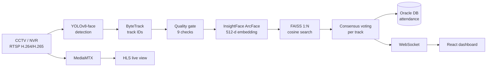

# Factory Face Recognition — CCTV Attendance at Shift-Change Scale

Real-time face recognition on existing factory CCTV. Cameras that were only recording now
log attendance on their own: detect → track → quality-check → embed → match → write to the
ERP database → push to a live dashboard.

Running in production at a factory with **~19,000 enrolled employees**.

> **Source code is private** (client deployment, built in a team of two). This repository
> documents the system, the engineering decisions, and the parts I built.

---

## Pipeline

| Stage | What it does |
|---|---|
| Detection | YOLOv8n-face on every sampled frame |
| Tracking | ByteTrack keeps one ID per person across frames, so decisions are made per *person*, not per frame |
| Quality gate | Size, detector confidence, yaw, pitch (up/down), brightness, blur, facial detail — every failing check is recorded, not just the first |
| Embedding | ArcFace (buffalo_l), up to 5 embeddings averaged per track |
| Matching | FAISS cosine search with a threshold **and** a margin over the second-best candidate |
| Consensus | Multiple agreeing votes before anything is written; 30 s cooldown per person |
| Output | Attendance rows in Oracle, live events over WebSocket, evidence crops on disk |

---

## The problems worth reading about

### 1. The quality filter was throwing away most real faces

A 5-minute live sample: **1,091 face crops from 36 people — only 22% passed every check.**
The rest were discarded before they were ever matched. Factory CCTV is wide-angle and
mounted high: faces are small, looking down, and turned sideways.

Loosening thresholds would have let bad crops produce false matches. Instead:

- Every crop is still embedded, but a failing crop counts at reduced weight and **cannot
  produce a match on its own**.
- **Temporal agreement:** if at least 3 crops taken ≥ 0.5 s apart independently name the
  same employee, the person is recognised — even when no single crop is good enough.
  Neighbouring frames often point at different people on their own; independent agreement
  over time doesn't.
- A safety valve: if one employee is "matched" for too many different people in a day, the
  extra matches go to a review queue instead of counting.

### 2. Shift change: 200–280 people in a few minutes

Running detection and recognition in the same loop meant faces were dropped exactly when
traffic peaked. The fix decouples them:

- Camera threads only detect and spool **every** crop to disk — nothing is dropped.
- One GPU worker drains the queue, best-looking crops first, as fast as the GPU allows.
- The backlog survives a restart, and attendance is stamped with the time the person was
  **seen**, not when the worker got to them.
- The dashboard shows how far behind live the queue is.

### 3. Spending GPU only where there are faces

Cameras self-demote when idle and promote instantly on any detection:

| Tier | Inference rate | When |
|---|---|---|
| Active | ~12 fps | Faces present |
| Reduced | ~3 fps | No face for 5 min |
| Idle | 1 frame / 30 s | No face for 15 min |

### 4. Making it debuggable by non-engineers

- A **Quality Gate** page shows every face the system processed — matched, rejected or
  unknown — with the crop and every metric, so thresholds are tuned on evidence.
- Every YOLO detection is drawn on the live view, colour-coded by pipeline stage.
- Operational failures (camera down, DB unreachable, queue stalled) surface as dashboard
  alerts instead of log lines nobody reads.

---

## What I built

- Track-level embedding averaging and capped embedding passes per track
- The multi-stage quality gate, including the low-detail and yaw checks, with full
  per-check reporting
- Deferred recognition queue that picks the best frame per track
- Live pipeline panel (queue depth, per-camera fps/status broadcast)
- Fix for a per-track state leak that eventually stopped detection
- Dashboard health alerts for operational failures
- Optional Intel iGPU inference via OpenVINO, and a CPU-only path
- Stopped Windows from throttling the backend when another app has focus
- Portable setup and packaging scripts (any Windows PC, Docker, GPU compose)
- Complete Oracle schema plus a migration for existing installs
- Performance fixes from a full system audit (RTSP resilience, P0–P3 issues)

---

## Stack

**ML / CV:** YOLOv8-face · InsightFace (ArcFace) · ByteTrack · FAISS · OpenCV · ONNX Runtime · OpenVINO
**Backend:** Python · FastAPI · WebSockets · JWT auth · Oracle DB
**Frontend:** React · Vite · HLS (MediaMTX)
**Ops:** Docker / docker-compose (GPU) · Windows Server · PowerShell automation · NVIDIA CUDA

---

## Dashboard pages

Dashboard (live head count, recent entries, camera status) · Live View (HLS + face
overlay) · Gallery · Visitors (unknown faces) · Reports & exports · Quality Gate ·
User Management (one-click ERP user sync)

*Screenshots are omitted: they contain real employees' faces.*
